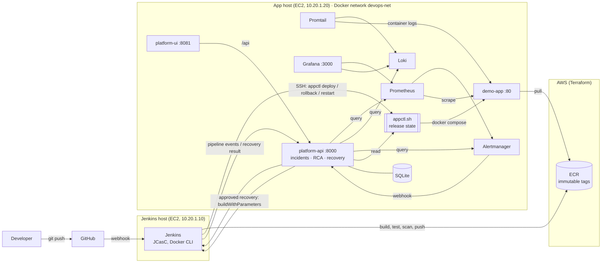
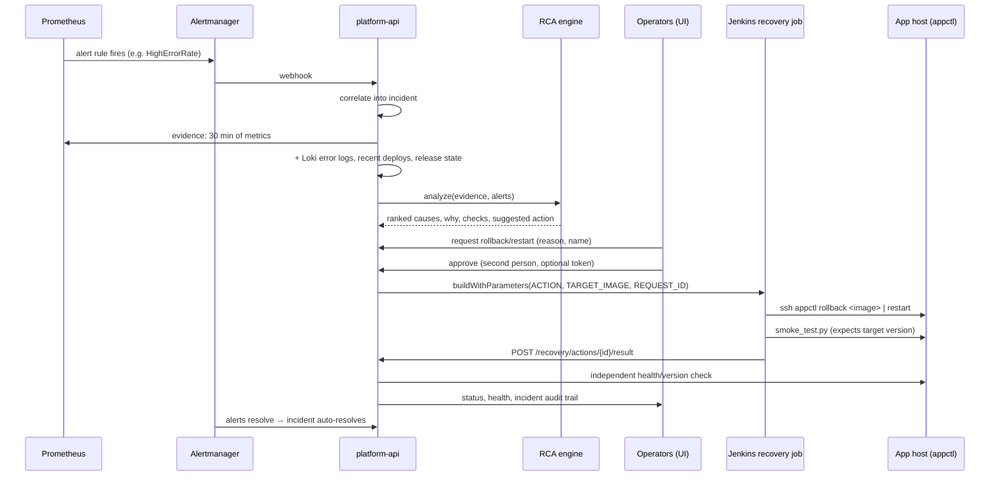

# Architecture

## Components and data flow

## Incident → recovery loop

## Design decisions

| Decision | Why |
|---|---|
| Jenkins is the only component with write access to the app host | One privileged path, with its deploy key, audit log and approval trail in one place. The web-facing API never mounts the Docker socket. |
| Immutable ECR tags `<build>-<sha>` | A rollback restores exactly the bytes that were tested. Tags trace back to commits. |
| `appctl.sh` holds the release state on the host | The deploy, auto-restore, promote and rollback logic is testable in isolation and shared by the pipeline and recovery. |
| Last good image = promoted only after post-deploy smoke tests | Automatic rollback has a trustworthy target. |
| Alerts carry `severity`, `category` and `service` | Correlation, the UI and RCA use labels, not alert names. |
| Fault injection is labelled as ground truth and never used as RCA input | Experiments can be evaluated without leaking the answer. |
| RCA is advisory; recovery needs explicit approval | Human control over production changes; the AI is an enhancement. |
| Every upstream is optional in the platform API | Partial outages degrade to "unavailable" instead of breaking the UI. |

## Security summary

* Admin ports (SSH, Jenkins, Grafana, Prometheus, platform) are limited to `admin_cidrs`;
  Terraform rejects `0.0.0.0/0`.
* IAM is least privilege: Jenkins can push to one ECR repo and the app host can only
  pull. There are no static AWS keys.
* Secrets (Jenkins admin password, Grafana password, deploy key, chaos token) are generated
  on the hosts, stored with mode 600 and git-ignored.
* The CI gates are Bandit, pip-audit, Trivy (image, plus an IaC report) and ruff; npm audit
  is clean.
* Optional `INGEST_TOKEN` for webhooks; an optional approval token and four-eyes rule for
  recovery. Rollback targets are restricted to images in the release history, and Jenkins
  re-validates them against the ECR repository pattern.
* Known limits: the services use plain HTTP, and the platform UI has no login beyond
  network restrictions and the approval token. Add an ALB with TLS and SSO/OIDC for
  production use.
